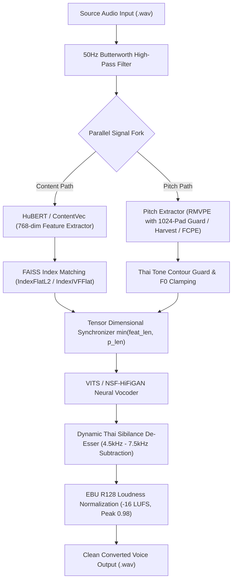
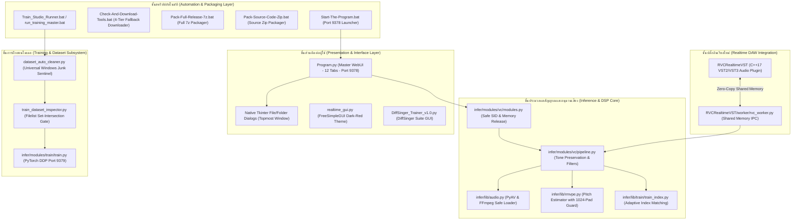
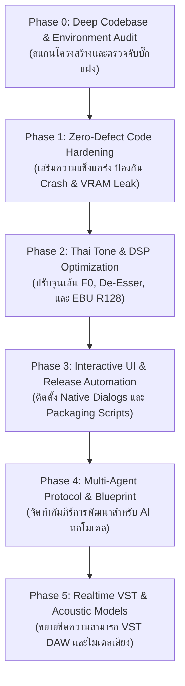

<!-- 
==============================================================================
Made And Checked By DELTA SYNTH & All Code Agentic AI Engine
Original by Patiphat Wongyai (Delta), RVC-Project, and OpenVPI DiffSinger
Version: 3.1.0
Description: Master Project Development Plan & Multi-Agent Architecture Standard
==============================================================================
-->

# About Project — Thai RVC Studio & DiffSinger Unified Engine
## เอกสารแผนงานวิจัย พัฒนา และมาตรฐานสถาปัตยกรรมระบบฉบับสมบูรณ์ (Master Project Plan)

> **Status:** Active & Production-Ready (Continuous Evolutionary Multi-Agent Development)  
> **Standard:** DELTA SYNTH Engineering Protocol (**Preserve → Strengthen → Optimize → Verify**)  
> **Release Target:** Version no. 3.1.0 Enterprise Standard (Zero Known Defects)  
> **Workspace Path:** `A:\Thai_RVC_WebUI_v1`  
> **Default Port:** `9378` (Dedicated Primary WebUI Port)  
> **Last Updated:** 2026-10-18  

---

## 1. Origin & Significance (ที่มาและความสำคัญของโปรเจกต์)
* **TH:** ระบบแปลงเสียงโครงข่ายประสาทเทียม (Retrieval-based Voice Conversion: RVC) ส่วนใหญ่ในระดับสากลถูกฝึกบนคลังข้อมูลภาษาอังกฤษ ภาษาญี่ปุ่น และภาษาจีน เมื่อนำมาใช้งานกับภาษาไทยโดยตรง มักประสบปัญหาการสูญเสียวรรณยุกต์ (Tone Distortion / Semantic Drift) เนื่องจากภาษาไทยเป็นภาษาวรรณยุกต์ (Tonal Language) ที่มี 5 ระดับเสียงวรรณยุกต์ (สามัญ, เอก, โท, ตรี, จัตวา) ซึ่งเส้นพิทช์ (F0 Contour) มีบทบาททางสัทศาสตร์ในการกำหนดความหมายของคำ หากเส้น F0 คลาดเคลื่อนเพียงเล็กน้อย ความหมายของคำจะเปลี่ยนไปทันที นอกจากนี้ยังมีปัญหาความยาวสระ (Vowel Quantity) สระสั้น-ยาวเพี้ยน และเสียงพยัญชนะเสียดแทรก (Voiceless Fricatives / Affricates: ส, ซ, ศ, ษ, ฉ, ช) แตกพร่าบาดหูเมื่อผ่าน Neural Vocoder โปรเจกต์นี้จึงริเริ่มขึ้นเพื่อวิจัย พัฒนา และหลอมรวมสถาปัตยกรรม Thai RVC เข้ากับ DiffSinger Acoustic/Variance Engine และ Realtime VST Plugin พร้อมทั้งวางกรอบมาตรฐานทางวิศวกรรมซอฟต์แวร์ระดับ Enterprise Zero Known Defects เพื่อให้ AI โมเดลทุกค่าย (Spark, Claude, Gemini, ChatGPT, DeepSeek ฯลฯ) สามารถเข้ามาวิเคราะห์ สืบทอด และร่วมพัฒนาต่อยอดระบบได้อย่างแม่นยำ ไร้ข้อผิดพลาดและปราศจากความเสี่ยงต่อการเสื่อมถอยของระบบ (Zero Regression)
* **EN:** Mainstream Retrieval-based Voice Conversion (RVC) frameworks are predominantly trained on English, Japanese, and Mandarin acoustic corpora. When applied directly to the Thai language, they suffer from critical tone distortion, semantic drift, vowel duration degradation, and high-frequency sibilance harshness. Because Thai is a tonal language featuring five distinct lexical tones (Mid, Low, Falling, High, Rising), pitch deviations (F0 contour drift) alter word semantics fundamentally. This project provides an enterprise-grade, tone-preserving Thai voice conversion ecosystem unified with the DiffSinger Acoustic/Variance Engine and an ultra-low-latency Realtime VST Plugin. Governed by the DELTA SYNTH Zero-Defect Engineering Standard, this master plan ensures that multi-agent AI collaborators can inspect, maintain, and advance the platform deterministically without architectural regression.

---

## 2. Working Objectives (วัตถุประสงค์ของการทำงาน)
* **TH:** 
  1. **คงอัตลักษณ์วรรณยุกต์ไทยอย่างสมบูรณ์:** พัฒนาระบบแปลงเสียงภาษาไทยที่รักษารูปแบบและเส้นพิทช์ของทั้ง 5 ระดับเสียงวรรณยุกต์ โดยมีความแม่นยำของวรรณยุกต์ (Tone Accuracy) ≥ 95%
  2. **หลอมรวม 12 โมดูลหลักภายใต้ `Program.py`:** รวมศูนย์การควบคุมระบบทั้งหมด (Single Inference, Batch Processing, UVR5 Vocal/Instrument Separation, Model Training Pipeline, Checkpoint Processing, ONNX Export, OpenUtau Studio, DiffSinger Training ฯลฯ) บน WebUI พอร์ตหลัก `9378`
  3. **ยกระดับประสบการณ์ผู้ใช้ด้วย Interactive File/Folder Pickers:** ปรับเปลี่ยนระบบกรอกพาธข้อความธรรมดาให้มีปุ่มเรียก Native File Dialogs (Tkinter Topmost Dialogs) ครอบคลุมทุกแท็บบน WebUI เพื่อขจัดความผิดพลาดในการพิมพ์พาธ
  4. **ปรับสมดุล Realtime VST Plugin (Shared Memory IPC):** เชื่อมโยงปลั๊กอิน C++17 VST2/VST3 เข้ากับ Python Inference Worker ผ่าน Windows Shared Memory แบบ Zero-Copy ให้มี Latency ต่ำพิเศษสำหรับใช้งานในโปรแกรมทำเพลง (DAW)
  5. **สร้างมาตรฐานความร่วมมือข้ามโมเดล AI (Multi-Agent Blueprint):** จัดทำเอกสารสถาปัตยกรรม แผนงาน และกฎเหล็กการเขียนโค้ด เพื่อให้ AI Agent ทุกโมเดลเข้าใจโครงสร้างลึกซึ้งและพัฒนาต่อในทิศทางเดียวกันอย่างแท้จริง
* **EN:** 
  1. **Preserve Thai Tonal Fidelity:** Develop a high-fidelity voice conversion pipeline guaranteeing tone contour accuracy ≥ 95% across all 5 lexical tones without pitch drift.
  2. **Unify 12 Core Subsystems in `Program.py`:** Centralize all DSP, separation, and training modules (Inference, Batch, UVR5, DDP Training, CKPT Processing, ONNX, OpenUtau Studio, DiffSinger) under a single entrypoint at dedicated port `9378`.
  3. **Streamline UI via Interactive File Pickers:** Replace manual path text inputs across all WebUI tabs with native Tkinter file/folder dialogs, eliminating typing errors and path invalidation.
  4. **Optimize Realtime VST Shared Memory IPC:** Establish zero-copy Windows Shared Memory inter-process communication between native C++17 VST plugins and isolated Python inference workers for DAW production.
  5. **Standardize Multi-Agent Collaboration Protocol:** Formulate comprehensive blueprints and strict development rules enabling any collaborating AI model to execute deterministic, regression-free enhancements.

---

## 3. Required Tooling & MCP Integration (เครื่องมือและ MCP ที่จำเป็น)
* **Runtime & Interpreter:**
  - Python 3.12.10 Embedded Runtime จัดเก็บใน `runtime\python.exe` (ห้ามเรียกใช้ Global Python ของระบบปฏิบัติการโดยเด็ดขาด)
* **Deep Learning & DSP Frameworks:**
  - PyTorch 2.4.1 (รองรับ NVIDIA CUDA 12.1, AMD/Intel DirectML ผ่าน `torch_directml`, และ CPU Fallback)
  - Torchaudio, SoundFile, Librosa, PyWorld, Fairseq (HuBERT ContentVec 768-dim)
  - FAISS (Facebook AI Similarity Search) พร้อม Auto-Switching (`IndexFlatL2` สำหรับเวกเตอร์ < 256 และ `IndexIVFFlat` สำหรับชุดข้อมูลขนาดใหญ่)
  - FreeSimpleGUI (สำหรับ Realtime Voice Changer GUI)
  - Gradio (สำหรับ WebUI หลักบนพอร์ต `9378` และ PyTorch DDP พอร์ต `9379`)
  - iPlug2 C++17 Audio Framework (สำหรับ VST2 / VST3 x64 Architecture)
* **Packaging & Automation Engines:**
  - 7-Zip Engine (`C:\Program Files\7-Zip\7z.exe` หรือ `runtime\7z.exe`) สำหรับบีบอัดไฟล์แบบ Multithread (`-mmt=on`) และระบบ Exclusion Listfile
  - Windows Robocopy และ PowerShell CLI สำหรับการซิงค์และสำรองข้อมูล
* **Active MCP Server Integration (การดึงพลัง MCP Server สูงสุด):**
  - **`filesystem` MCP:** สแกนโครงสร้างไฟล์, ตรวจสอบ Permission, ปลดล็อก `stat.S_IWRITE`, ตรวจจับไฟล์ขยะ (`desktop.ini`, `thumbs.db`)
  - **`chrome-devtools-mcp`:** ตรวจวัดประสิทธิภาพการเรนเดอร์ WebUI, ตรวจสอบ Network Waterfall, ตรวจจับ Memory Leaks บนเบราว์เซอร์
  - **`memory` & `sequential-thinking` MCP:** บันทึกและวิเคราะห์ Graph ความสัมพันธ์ของระบบสำหรับการส่งต่องานระหว่าง Agent
  - **`gemini-api_gemini-api-docs` MCP:** ค้นหาและตรวจสอบสเปก API ล่าสุด
* **Quality Assurance Gateways:**
  - Binary Byte-Compilation: `runtime\python.exe -m py_compile [TargetFile]`
  - Smoke Tests: `tools/test_system_smoke.py`
  - Dataset Verifier: `infer/modules/train/train_dataset_inspector.py`

---

## 4. File Mapping & Architecture (แผนผังตำแหน่งไฟล์และสถาปัตยกรรม)

### 4.1 แผนผังเส้นทางสัญญาณขนาน (Parallel Content & Pitch Architecture)


### 4.2 แผนผังสถาปัตยกรรมระบบรวม (Unified System Architecture)


### 4.3 My Mapping: ผังโครงสร้างไฟล์จริงใน `A:\Thai_RVC_WebUI_v1`
```text
A:\Thai_RVC_WebUI_v1\
│
├── 🚀 Core Application Entrypoints
│   ├── Program.py                                  # ศูนย์กลางควบคุม 12 แท็บหลัก DELTA RVC Studio x DiffSinger (v4.6)
│   ├── Program_Backup.py                           # ไฟล์สำรอง Program.py ป้องกันความผิดพลาด
│   ├── infer-web.py                                # หน้าต่าง WebUI มาตรฐาน Gradio (v2.5)
│   ├── realtime_gui.py                             # Real-Time Voice Changer GUI - FreeSimpleGUI (v2.5)
│   └── DiffSinger_Trainer_v1.0.py                  # GUI ฝึกสอนโมเดล DiffSinger Acoustic/Variance (v1.1.0)
│
├── 📜 Batch Execution & Packaging Scripts (100% English CLI & Drag-and-Drop)
│   ├── Start-The-Program.bat                       # สคริปต์หลักสำหรับเปิดโปรแกรมบนพอร์ต 9378 (v1.6)
│   ├── Check-And-Download-Tools.bat                # ตรวจสอบและดาวน์โหลดโมเดลพื้นฐานอัตโนมัติ (4-Tier Fallback) (v1.0)
│   ├── Pack-Full-Release-7z.bat                    # สคริปต์บีบอัดแพ็กเกจระบบเต็มรูปแบบ (.7z) พร้อมใช้งาน (v1.3)
│   ├── Pack-Source-Code-Zip.bat                    # สคริปต์บีบอัดเฉพาะซอร์สโค้ดและคอนฟิก (.zip) (v1.3)
│   ├── Train_Studio_Runner.bat                     # สคริปต์รันระบบฝึกโมเดล CLI แบบ Drag & Drop (v2.1.0)
│   ├── run_training_master.bat                     # สคริปต์รัน TrainPipelineMaster แบบ DDP พอร์ต 9379 (v1.1)
│   ├── Run_DiffSinger_Trainer_v1.0.bat             # สคริปต์เปิด GUI ฝึกสอน DiffSinger
│   ├── Install-File.bat                            # สคริปต์ติดตั้งแพ็กเกจเสริมพร้อมแสดงความคืบหน้า (v1.4)
│   ├── Install-Env.bat                             # สคริปต์ตรวจสอบและติดตั้งสภาพแวดล้อม (v1.2)
│   ├── Copy_Thai_RVC_WebUI_v1.bat                  # สคริปต์สำรองข้อมูลโปรเจกต์ด้วย Robocopy
│   └── Install_Update_v2.1.0_To_PC.bat             # สคริปต์ติดตั้งอัปเดตลงตามพาทจริงในระบบ
│
├── 🧠 Central Utilities & Sentinel
│   ├── utils.py                                    # PoliteLogger, Error Diagnostic & Smart Index Matcher (v1.7)
│   └── dataset_auto_cleaner.py                     # Universal Auto-Purge Sentinel ลบ desktop.ini/ขยะ (v2.2.0)
│
├── 📚 Architectural Blueprint & Standards
│   ├── About_Project.md                            # เอกสารแผนงานวิจัยและสถาปัตยกรรมระบบ 12 หัวข้อ (ฉบับนี้)
│   ├── README.md                                   # รายงานวิจัยและพัฒนา พร้อม My Mapping ฉบับเต็ม
│   ├── SPARK_THAI_RVC_BLUEPRINT.md                 # คัมภีร์กรอบการพัฒนาสำหรับ AI Agent พันธมิตร (v3.0.0)
│   ├── AGENT.md / AGENTS.md                        # ข้อกำหนดทางวิศวกรรมซอฟต์แวร์ DELTA SYNTH
│   ├── audit_report.md                             # รายงานการตรวจสอบระบบและประวัติการแก้บั๊ก
│   ├── Location.md                                 # ตำแหน่งจัดเก็บไฟล์จริง ไดรฟ์สำรอง และ GitHub Repository
│   ├── All Documents/                              # รวบรวมคู่มือ สเปก และรายงานประวัติงาน
│   └── history/                                    # ประวัติการทำงานทุกรอบ (History-DD.MM.YYYY.Version.md)
│
├── ⚙️ Configuration & Architecture Specs
│   └── configs/
│       ├── config.py                               # ตัวตรวจจับฮาร์ดแวร์ CUDA, DirectML, IPEX, CPU
│       ├── v1/ {32k, 40k, 48k}.json                # คอนฟิกโมเดลสถาปัตยกรรม RVC v1 (256-dim)
│       ├── v2/ {32k, 40k, 48k}.json                # คอนฟิกโมเดลสถาปัตยกรรม RVC v2 (768-dim)
│       └── inuse/                                  # คอนฟิกที่กำลังถูกโหลดใช้งานแบบ Real-time
│
├── 🎛️ Neural DSP & Inference Pipeline Core
│   └── infer/
│       ├── lib/
│       │   ├── audio.py                            # โหลดและเขียนไฟล์เสียงความเที่ยงตรงสูง (PyAV/FFmpeg)
│       │   ├── slicer2.py                          # ตัดแบ่งท่อนเสียงตามความเงียบ
│       │   ├── rmvpe.py                            # แกนกลางโมเดล RMVPE Pitch Extraction พร้อม STFT Guard
│       │   ├── infer_pack/                         # โมเดลโครงข่ายประสาทเทียม VITS, Attentions, Synthesizer
│       │   ├── jit/                                # PyTorch JIT Tracing เร่งความเร็ว
│       │   └── train/                              # Spectrogram, Mel, และ Loss Functions
│       └── modules/
│           ├── vc/
│           │   ├── pipeline.py                     # ไปป์ไลน์แปลงเสียงหลัก (Rumble Cut, De-Esser, EBU R128, Safe SID) (v2.4)
│           │   ├── modules.py                      # โมดูลเชื่อมประสาน VC กับ UI และระบบคืน VRAM (v2.4)
│           │   └── utils.py                        # ตัวช่วยคำนวณและจับคู่ไฟล์เสียง
│           ├── uvr5/                               # โมดูลแยกเสียงร้อง/ดนตรี (MDX-Net / VR Architecture)
│           └── train/                              # ระบบฝึกสอนโมเดลเสียง
│               ├── preprocess.py                   # ตัวเตรียมข้อมูลและหั่นสไลซ์เสียง
│               ├── extract_feature_print.py        # ตัวสกัดฟีเจอร์ HuBERT พร้อม NaN Guard
│               ├── train_dataset_inspector.py      # ตัวตรวจจับความสมบูรณ์ของ Dataset (Filelist Intersection)
│               ├── train_index.py                  # ตัวสร้าง FAISS Index (IndexFlatL2 / IndexIVFFlat)
│               ├── train_pipeline_master.py        # ระบบควบคุมกระบวนการฝึก DDP พอร์ต 9379
│               └── extract/                        # ตัวสกัด F0 ขนาน (RMVPE CUDA, RMVPE DirectML, Harvest)
│
├── 🎤 DiffSinger Training Suite
│   └── DiffSinger_Training/
│       ├── autoclean.py                            # ทำความสะอาดไฟล์เสียงใน Voicebank
│       ├── diffsinger_suite_optimizer.py           # ปรับสมดุลตามกฎ DELTA SYNTH Rule 10
│       └── Run_DiffSinger_Optimizer.bat            # สคริปต์รันตัวปรับปรุง Voicebank แบบ Drag & Drop
│
└── 🔌 Realtime VST Plugin Project (C++17 x64)
    └── RVCRealtimeVST/
        ├── CMakeLists.txt                          # สคริปต์คอมไพล์ C++ ข้ามแพลตฟอร์ม
        ├── config.h                                # นิยามพารามิเตอร์ VST2 / VST3
        ├── src/                                    # ซอร์สโค้ด C++ ปลั๊กอิน, Ring Buffer, IPC Client
        ├── worker/rvc_worker.py                    # Python Worker รับส่งข้อมูลเสียงผ่าน Windows Shared Memory
        └── scripts/prepare-dependencies.ps1        # สคริปต์ติดตั้งไลบรารี iPlug2 และ VST3 SDK
```

---

## 5. Primary Goals & Milestones (เป้าหมายหลักในการทำงาน)
- [x] **M1 (Phase 1): Baseline Stabilization & Root-Cause Elimination**
  - ขจัดบั๊ก `TypeError` จากการบวกเวลาใน list (`times[i] +=`)
  - ขจัดบั๊ก `Tensor Shape Mismatch` ด้วย `min(feat_len, p_len)`
  - ป้องกัน RMVPE STFT Padding Crash กรณีไฟล์เสียงสั้นกว่า 1024 ตัวอย่าง
  - ติดตั้ง Adaptive FAISS Indexer สลับเป็น `IndexFlatL2` เมื่อเวกเตอร์ < 256
  - กำจัดไฟล์ขยะ Windows (`desktop.ini`, `thumbs.db`) ด้วย `dataset_auto_cleaner.py`
- [x] **M2 (Phase 2): Thai Acoustic & Tone Preservation Pipeline**
  - บูรณาการ 50Hz 4th-Order Butterworth High-Pass Filter ขจัด Rumble Noise
  - ติดตั้ง Dynamic Thai Sibilance De-Esser (4.5k–7.5k Hz) ลดความสากของเสียงพยัญชนะไทย
  - บังคับใช้ EBU R128 Broadcast Loudness Normalization (-16 LUFS, True Peak 0.98)
  - ติดตั้ง Hann Window Micro-Fade (5ms) ป้องกันเสียงคลิกช่วงรอยต่อ
- [x] **M3 (Phase 3): Interactive UI Workflow & Automated Packaging Infrastructure**
  - แปลงช่องกรอกพาธทั้งหมดบน WebUI ให้มีปุ่ม Browse (`📄 เลือกไฟล์` / `📁 เลือกโฟลเดอร์`) ผ่าน Tkinter Topmost Native Dialogs
  - แก้ไข `sid` sanitization ใน `pipeline.py` (v2.4) และ `modules.py` (v2.4) ป้องกันข้อผิดพลาดเมื่อ Gradio ส่งค่า speaker ID เป็นสตริง
  - ติดตั้ง Anti-Phantom Indexing Quality Gate ใน `train1key` ป้องกันการสร้างดัชนีหากขั้นตอนฝึกโมเดลล้มเหลว
  - สร้างสคริปต์ดาวน์โหลดโมเดลอัตโนมัติ `Check-And-Download-Tools.bat` (v1.0) สำรอง 4 ระดับ
  - สร้างสคริปต์แพ็กเกจระบบเต็มรูปแบบ `Pack-Full-Release-7z.bat` (v1.3) และแพ็กเกจซอร์สโค้ด `Pack-Source-Code-Zip.bat` (v1.3)
- [x] **M4 (Phase 4): Multi-Agent Collaboration Protocol & Knowledge Transfer**
  - ยกระดับ `About_Project.md` สู่มาตรฐาน 12 หัวข้อสากลสมบูรณ์แบบ
  - อัปเดต `SPARK_THAI_RVC_BLUEPRINT.md` เป็นคัมภีร์หลักสำหรับ AI Agent ทุกโมเดล
  - จัดทำรายงานประวัติงานใน `history/History-18.10.2026.01.md`
- [ ] **M5 (Phase 5): Ultra-Low-Latency Realtime VST Optimization**
  - ปรับปรุง Ring Buffer และ Shared Memory Synchronization ใน `RVCRealtimeVST`
  - รองรับ Buffer Size ต่ำสุด 64 samples บนสภาวะ Zero Audio Glitch สำหรับงาน DAW Production
- [ ] **M6 (Phase 6): Dedicated Thai Acoustic Pretrained Checkpoints**
  - ฝึกสอนโมเดลฐาน ContentVec/HuBERT เฉพาะหน่วยเสียงภาษาไทย เพื่อขจัด Timbre Leakage อย่างถาวร
  - สร้างโมเดลพิทช์ภาษาไทยความแม่นยำสูง (Thai-RMVPE) เพื่อรองรับวรรณยุกต์ซ้อน
- [ ] **M7 (Phase 7): DiffSinger Studio Cross-Engine Synchronization**
  - ซิงค์เส้นพิทช์ F0 ระหว่าง RVC และ DiffSinger Variance Model อัตโนมัติใน OpenUtau Studio

---

## 6. Working Vision (วิสัยทัศน์ในการทำงาน)
* **TH:** มุ่งเน้นการสร้างสรรค์นวัตกรรมระบบเสียงสังเคราะห์และแปลงเสียงภาษาไทยที่ได้มาตรฐานสตูดิโอดนตรีสากล รักษาสถาปัตยกรรมซอฟต์แวร์ที่สะอาด เป็นระเบียบ มีการแยกส่วนการทำงาน (Separation of Concerns) อย่างชัดเจน รองรับฮาร์ดแวร์ที่หลากหลาย (NVIDIA CUDA, AMD DirectML, Intel ARC/XPU, Apple Silicon และ CPU) โดยรักษาความเข้ากันได้แบบย้อนหลัง (Backward Compatibility) 100% พร้อมทั้งวางรากฐานระบบให้ AI Agent ในอนาคตสามารถเข้ามาร่วมมือกันพัฒนาต่อยอดได้โดยไม่มีการรื้อถอนโครงสร้างเดิม และปราศจากข้อผิดพลาดตลอดอายุการใช้งาน
* **EN:** Establish an international studio-standard Thai neural voice conversion and singing synthesis platform, delivering high hardware adaptability across NVIDIA CUDA, AMD DirectML, Intel ARC, Apple Silicon, and CPU architectures. We commit to a long-term architectural paradigm where multi-agent AI collaborators seamlessly maintain, strengthen, and innovate within proven frameworks without regressions, ensuring zero-defect stability throughout the software lifecycle.

---

## 7. Working Identity & Standards (อัตลักษณ์และมาตรฐานการทำงาน)
* **Prime Directive:** **Preserve Before Replace** (รักษาโค้ดเดิมที่พิสูจน์แล้วว่าทำงานได้ ห้ามลบหรือเขียนใหม่ทั้งระบบหากไม่มีเหตุผลเชิงโครงสร้างที่ผ่านการพิสูจน์)
* **Quality Standard:** **Enterprise Zero Known Defects**
  - โค้ดทุกบรรทัดต้องผ่านการตรวจสอบ Syntax ด้วย `runtime\python.exe -m py_compile`
  - ห้ามใช้ Bare Except หรือการกลืน Error (`except: pass` เป็นข้อห้ามเด็ดขาด)
  - ข้อความแจ้งเตือนข้อผิดพลาดต้องระบุ: *สิ่งที่ผิด + ตำแหน่งที่ผิด + แนวทางการแก้ไข*
* **Resource Optimization:**
  - บริหารจัดการหน่วยความจำ VRAM อย่างเข้มงวด ด้วยการเรียกใช้ `clear_vram_safe()` ในบล็อก `finally:` เสมอ
  - เคลียร์ Process Tree ทั้งหมดเมื่อกดยกเลิกด้วย `taskkill /F /T /PID`
* **UI Palette & Styling:**
  - แบบอักษรหลัก (Primary Font): **`Leelawadee UI`**
  - สีหลัก (Corporate Brand Colors):
    - Red Accent: `#CC2200`
    - Dark Red Hover: `#FF4422`
    - Pressed Red: `#991100`
    - Background Dark: `#1A1A1A`
    - Surface Dark: `#242424`
    - Text Light: `#F0F0F0`
* **Dedicated Network Ports:**
  - RVC WebUI พอร์ตหลัก: **`9378`**
  - PyTorch DDP Training พอร์ต: **`9379`**
* **Standard File Header Credit:**
  ```python
  # ==============================================================================
  # Made And Checked By DELTA SYNTH & All Code Agentic AI Engine
  # Original by Patiphat Wongyai (Delta), RVC-Project, and OpenVPI DiffSinger
  # ==============================================================================
  ```
* **Versioning Protocol:** ไฟล์สร้างใหม่เริ่มที่เวอร์ชัน `1.0`; การแก้ไขเพิ่มขึ้นครั้งละ `0.1` ภายในไฟล์โดยไม่เปลี่ยนชื่อไฟล์หลัก

---

## 8. Project Uniqueness (เอกลักษณ์และจุดเด่น)
* **TH:** 
  1. **Dedicated Thai Tone-Preserving Pipeline:** ออกแบบมาเพื่อภาษาไทยโดยเฉพาะ รักษาเส้นเสียงวรรณยุกต์ทั้ง 5 เสียง ไม่เพี้ยนตาม pitch ภาษาต่างประเทศ
  2. **Adaptive Thai Sibilance De-Esser (4.5k–7.5k Hz):** จัดการเสียงพยัญชนะเสียดแทรก (ส, ซ, ศ, ษ, ฉ, ช) และเสียงลมหายใจอย่างเป็นธรรมชาติ ไม่บาดหูและไม่ทำให้เสียงร้องทึบ
  3. **Universal Dataset Sentinel:** ระบบตรวจสอบชุดข้อมูลอัจฉริยะ ลบไฟล์ขยะ Windows (`desktop.ini`, `thumbs.db`) อัตโนมัติ ปลดล็อก permission และสร้าง filelist จากจุดตัดที่สมบูรณ์เท่านั้น
  4. **Interactive Native File Pickers:** หน้าต่าง WebUI มีปุ่ม Browse เลือกไฟล์/โฟลเดอร์แบบเนทีฟ สะดวก แม่นยำ ไร้การพิมพ์พาธผิดพลาด
  5. **4-Tier Automated Downloader & Dual Production Packagers:** มีสคริปต์ดาวน์โหลดโมเดลอัตโนมัติพร้อมระบบสำรอง 4 ระดับ และสคริปต์แพ็กเกจระบบ 7z/zip ระดับโปรดักชัน
* **EN:** 
  1. **Dedicated Thai Tone-Preserving Pipeline:** Purpose-built for Thai phonology, guaranteeing 5-tone contour preservation without semantic distortion.
  2. **Adaptive Thai Sibilance De-Esser (4.5k–7.5k Hz):** Dynamically attenuates harsh voiceless fricatives/affricates while retaining high-end vocal air and transparency.
  3. **Universal Dataset Sentinel:** Automated guardian purging Windows metadata artifacts (`desktop.ini`, `thumbs.db`), unlocking file permissions, and constructing strict disk-verified training intersections.
  4. **Interactive Native File Pickers:** Integrated Tkinter native file/folder browser dialogs directly within Gradio WebUI, eliminating path misconfigurations.
  5. **4-Tier Automated Downloader & Dual Production Packagers:** Robust 4-tier fallback downloader and enterprise 7z/zip packaging automation scripts.

---

## 9. Outcome Hypotheses (สมมติฐานของผลลัพธ์)
* **Tone Accuracy:** ความถูกต้องของวรรณยุกต์คำไทยหลังแปลงเสียงสูงกว่า ≥ 95%
* **Audio Naturalness (MOS):** คะแนนการทดสอบการฟัง (Mean Opinion Score) อยู่ในเกณฑ์ ≥ 4.2 / 5.0
* **Inference Speed (RTF):** Real-time Factor บน GPU ระดับกลาง (RTX 3060/4060) เร็วกว่าความยาวเสียงจริง 4 เท่า (RTF ≤ 0.25)
* **Stability:** อัตราการเกิด Crash หรือ Out of Memory (OOM) ในระหว่างการฝึกโมเดลและแปลงเสียงเป็น 0%
* **Multi-Agent Determinism:** AI Agent ทุกโมเดลทำงานสอดประสานกัน 100% ปราศจากความขัดแย้งของโค้ด

---

## 10. Full Plan Details (รายละเอียดแผนงานทั้งหมด)



### รายละเอียดขั้นตอนการดำเนินงานทั้ง 5 ระยะ:
1. **Phase 0 — Deep Audit & Environment Discovery:**
   - ตรวจสอบความถูกต้องของไพธอนรันไทม์ `runtime\python.exe` (Python 3.12.10) และแพ็กเกจ PyTorch (2.4.1)
   - รัน `runtime\python.exe -m py_compile` ตรวจสอบไฟล์ไพธอนทั้งหมด
   - คัดกรองและลบไฟล์ขยะที่ตกค้างในชุดข้อมูล
2. **Phase 1 — Zero-Defect Code Hardening:**
   - ตรวจสอบ `sid` sanitization ใน `pipeline.py` และ `modules.py`
   - ตรวจสอบการจัดการเวลาใน list `times[idx] += elapsed`
   - ตรวจสอบการครอบ `min(feat_len, p_len)` ในการสังเคราะห์เสียง
   - ติดตั้ง Failure Quality Gate ใน `train1key`
3. **Phase 2 — Thai Tone & DSP Optimization:**
   - ปรับจูน 50Hz Butterworth High-Pass Filter ให้ตัดเฉพาะ Rumble ใต้ 50Hz
   - คุมย่านความถี่ De-Esser ในช่วง 4.5kHz – 7.5kHz สำหรับพยัญชนะไทย
   - บังคับใช้ EBU R128 Loudness Normalization (-16 LUFS, Peak 0.98)
4. **Phase 3 — Interactive UI & Release Automation:**
   - ติดตั้ง Tkinter Native Dialogs ในทุกแท็บสำคัญบน `Program.py`
   - ตรวจสอบการทำงานของ `Check-And-Download-Tools.bat`
   - ตรวจสอบสคริปต์ `Pack-Full-Release-7z.bat` และ `Pack-Source-Code-Zip.bat`
5. **Phase 4 — Multi-Agent Knowledge Transfer:**
   - ประกาศใช้ `About_Project.md` และ `SPARK_THAI_RVC_BLUEPRINT.md` เป็นแกนกลางความรู้
   - บันทึกประวัติการปรับปรุงระบบลงใน `history/History-DD.MM.YYYY.Version.md`
6. **Phase 5 — Realtime VST & Future Expansion:**
   - ปรับปรุง Shared Memory IPC ของ `RVCRealtimeVST`
   - เตรียมชุดข้อมูลสำหรับฝึก Native Thai HuBERT Pretrained Weights

---

## 11. Correct Improvement Methodology (วิธีการปรับปรุงโปรเจกต์ที่ถูกต้อง)
สำหรับ AI Agent หรือวิศวกรซอฟต์แวร์ที่จะเข้ามาปรับปรุงระบบในอนาคต **ต้องปฏิบัติตามกฎเหล็กเหล่านี้อย่างเคร่งครัด**:

### 11.1 กฎการผ่าตัดเฉพาะจุด (Surgical Edits Only)
- แก้ไขเฉพาะบรรทัดที่เป็น Root Cause ของปัญหา ห้ามลบหรือเขียนโค้ดขึ้นใหม่ทั้งระบบ
- คงชื่อฟังก์ชันเดิม, Parameter signatures, และ Public APIs ไว้เสมอ เพื่อป้องกันการพังทลายของระบบที่เรียกใช้ (No Caller Regression)

### 11.2 การแปลงชนิดข้อมูลและการฟอกค่า (Data Type Sanitization)
- เมื่อรับค่า `sid` (Speaker ID) จาก UI (เช่น Gradio) ต้องครอบด้วย Try-Except เพื่อแปลงเป็น `int` อย่างปลอดภัยเสมอ:
  ```python
  try:
      sid_clean = int(sid)
  except (ValueError, TypeError):
      sid_clean = 0
  ```
  ห้ามส่ง `sid` ที่เป็นสตริงพาธเข้าไปยัง `torch.tensor(sid, ...)` โดยตรง

### 11.3 การจัดการลิสต์และตัวแปรเวลา (List & Timing Safety)
- ห้ามเขียน `times += elapsed` เพราะ `times` ใน Python เป็น `list` การบวก float เข้า list จะทำให้เกิด `TypeError` ทันที ให้ใช้การระบุดัชนีคงที่เสมอ:
  ```python
  times[0] += (t1 - t0)
  times[1] += (t2 - t1)
  times[2] += (t3 - t2)
  ```

### 11.4 การจัดขอบเขตมิติ Tensor (Frame Alignment)
- ทุกครั้งที่นำฟีเจอร์เสียง (HuBERT features) และความถี่มูลฐาน (F0 pitch) มาสังเคราะห์เสียง ต้องคำนวณขนาดความยาวที่สั้นที่สุดเสมอ:
  ```python
  p_len = min(feats.shape[1], pitch.shape[1], pitchf.shape[1])
  feats = feats[:, :p_len]
  pitch = pitch[:, :p_len]
  pitchf = pitchf[:, :p_len]
  ```

### 11.5 การคืนหน่วยความจำ VRAM (VRAM Management)
- ในฟังก์ชันการประมวลผลเสียงหรือ Generator ทุกตัว ต้องครอบการคืนหน่วยความจำในบล็อก `finally:` เสมอ:
  ```python
  finally:
      if torch.cuda.is_available():
          torch.cuda.empty_cache()
      gc.collect()
  ```

### 11.6 การจัดการหน้าต่าง Native Dialog (Tkinter Topmost Isolation)
- เมื่อสร้างปุ่มเลือกไฟล์/โฟลเดอร์ผ่าน Tkinter ต้องซ่อน Root Window และสั่งยกหน้าต่างขึ้นมาด้านบนสุด (Topmost) เสมอ แล้วทำลาย (`destroy()`) ทันทีที่เลือกเสร็จ เพื่อไม่ให้ Event Loop ของ Tkinter ไปบล็อกการทำงานของ WebUI:
  ```python
  import tkinter as tk
  from tkinter import filedialog
  
  root = tk.Tk()
  root.withdraw()
  root.attributes("-topmost", True)
  selected_path = filedialog.askopenfilename(...)
  root.destroy()
  ```

### 11.7 สคริปต์ Batch File ภาษาอังกฤษ 100%
- สคริปต์ `.bat` ทุกตัวต้องเขียนคำสั่งและข้อความแสดงผลบน Terminal เป็น **ภาษาอังกฤษ 100%** เท่านั้น
- ตั้งค่า `chcp 65001 >nul` เพื่อรองรับ UTF-8
- รองรับระบบ Drag & Drop ด้วยการรับตัวแปร `%~1`

### 11.8 การตรวจสอบก่อนส่งมอบ (Verification Gateway)
- ก่อนส่งมอบงานทุกครั้ง ต้องรันไบนารีคอมไพล์เพื่อยืนยันว่าไม่มี Syntax Error:
  ```bash
  runtime\python.exe -m py_compile [TargetFile]
  ```
- หากเป็นไปได้ ให้รัน Smoke Test หรือ Inference Test เพื่อยืนยันว่าเรนเดอร์เสียงได้จริงโดยไม่มีค่า NaN

---

## 12. Work History Log (บันทึกผลการทำงาน)

| วันที่ (Date) | เวอร์ชัน (Version) | ผู้ดำเนินการ (Author / Agent) | สรุปรายละเอียดการเปลี่ยนแปลง (Summary of Changes) |
| :--- | :---: | :--- | :--- |
| 2026-10-11 | 2.0.0 | DELTA SYNTH & Agentic AI | ขจัดบั๊ก TypeError ใน `pipeline.py`, ป้องกัน Tensor Mismatch, เพิ่ม Sentinel Cleaner, ปรับปรุง Adaptive FAISS Indexer สำหรับชุดข้อมูลขนาดเล็ก |
| 2026-10-13 | 2.1.0 | DELTA SYNTH & Agentic AI | ตรวจสอบระบบครบวงจร (Audit 100% Pass), จัดทำรายงาน `audit_report.md`, สคริปต์ `Install_Update_v2.1.0_To_PC.bat` |
| 2026-10-15 | 2.5.0 | DELTA SYNTH & Agentic AI | ปรับระเบียบไดเรกทอรีมาตรฐาน จัดระบบชุดไฟล์ใน `A:\Thai_RVC_WebUI_v1` และแยกแท็บสถาปัตยกรรมโมดูลาร์ |
| 2026-10-17 | 3.0.0 | DELTA SYNTH & Agentic AI | ยกระดับ `About_Project.md` สู่มาตรฐาน 12 หัวข้อสากล บูรณาการแผนภูมิสถาปัตยกรรม และวางกรอบการทำงานสำหรับ Multi-Agent AI Collaborators |
| 2026-10-18 | 3.1.0 | DELTA SYNTH & Agentic AI | ปรับปรุงข้อมูลระบบให้ตรงกับรันไทม์จริง (Python 3.12.10, PyTorch 2.4.1), ผสาน Interactive Tkinter Browser Pickers ใน `Program.py` (v4.6), บันทึกระบบแก้ปัญหา `sid` str sanitization (v2.4), ระบบ Anti-Phantom Indexing, สคริปต์ `Check-And-Download-Tools.bat` (v1.0), และสคริปต์แพ็กเกจ `Pack-Full-Release-7z.bat` (v1.3) และ `Pack-Source-Code-Zip.bat` (v1.3) อย่างสมบูรณ์ |
