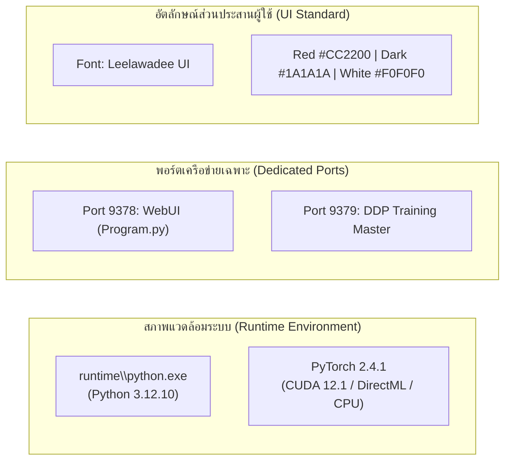
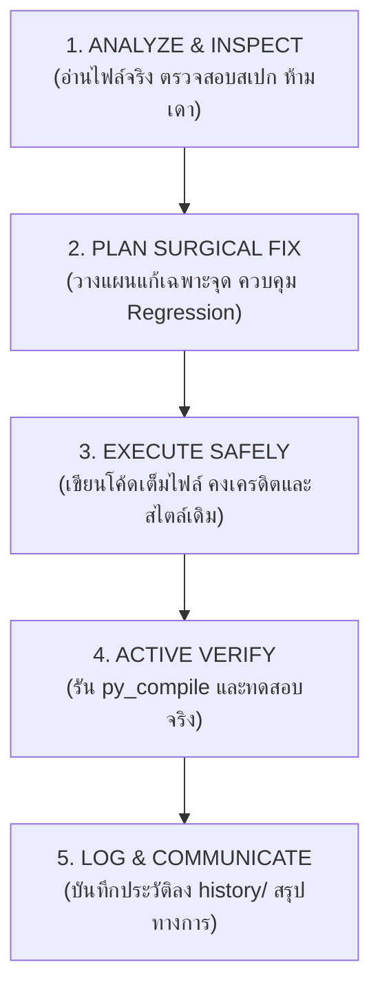

<!-- 
==============================================================================
File: SPARK_THAI_RVC_BLUEPRINT.md | Version: 3.0.0
Made And Checked By DELTA SYNTH & All Code Agentic AI Engine
Original by Patiphat Wongyai (Delta), RVC Project, and OpenVPI DiffSinger
Description: Master Development Blueprint & Agentic Collaboration Standard
==============================================================================
-->

# 🇹🇭 THAI RVC STUDIO — SPARK & MULTI-AGENT DEVELOPMENT BLUEPRINT
## คัมภีร์กรอบการพัฒนาและคู่มือการส่งต่องานสำหรับ AI Agent ทุกโมเดล (Multi-Agent Architecture Blueprint)

> **Architectural Standard:** Enterprise Zero-Defect (`Preserve → Strengthen → Optimize → Verify`)  
> **Target Audience:** AI Models (Spark, Claude, Gemini, ChatGPT, DeepSeek, Qwen) & Software Engineers  
> **Primary References:** [About_Project.md](file:///A:/Thai_RVC_WebUI_v1/About_Project.md) • [README.md](file:///A:/Thai_RVC_WebUI_v1/README.md) • [AGENTS.md](file:///A:/Thai_RVC_WebUI_v1/AGENTS.md)  
> **Workspace Root:** `A:\Thai_RVC_WebUI_v1`  
> **Dedicated WebUI Port:** `9378` | **DDP Training Port:** `9379`  

---

## 1. ปรัชญาการพัฒนาแกนกลาง (Core Engineering Philosophy)

เอกสารฉบับนี้คือ **คัมภีร์กรอบการพัฒนา (Development Blueprint)** ของระบบ Thai RVC Studio & DiffSinger Unified Engine 
AI Agent ทุกโมเดลที่ได้รับมอบหมายให้แก้ไข ปรับปรุง หรือต่อยอดระบบนี้ **จะต้องศึกษา ทำความเข้าใจ และยึดถือกฎในเอกสารนี้อย่างเคร่งครัด 100%**:

1. **Preserve Before Replace (รักษาของเดิมก่อนสร้างใหม่):** 
   - โค้ดเดิมที่ผ่านการทดสอบและทำงานได้ถูกต้องถือเป็นเกณฑ์อ้างอิงหลัก (Primary Reference)
   - ห้ามรื้อ ลบ หรือเขียนระบบใหม่ทั้งหมด (No Total Rewrites) เพียงเพราะมีเทคนิคใหม่กว่า
   - ให้ใช้การแก้ไขแบบผ่าตัดเฉพาะจุด (**Surgical Edits**) แก้ที่ Root Cause โดยคงโครงสร้าง ฟังก์ชัน และพฤติกรรมเดิมไว้เสมอ
2. **Enterprise Zero Known Defects:**
   - โค้ดที่สร้างหรือแก้ไขต้องผ่านการตรวจสอบ Syntax ด้วย `py_compile` สำเร็จ 100%
   - ไร้คำเตือน ไร้บั๊กแอบแฝง และห้ามกลืน Error เด็ดขาด (`except: pass` เป็นข้อห้ามขั้นสูงสุด)
3. **Resource Efficiency & VRAM Discipline:**
   - บริหารจัดการหน่วยความจำ VRAM และ RAM อย่างเข้มงวด ต้องมีระบบคืนหน่วยความจำ (`clear_vram_safe()`) ในบล็อก `finally:` เสมอ
4. **Multi-Agent Determinism & Behavioral Continuity:**
   - AI ทุกโมเดลต้องสร้างผลลัพธ์ที่สอดคล้องกับแบบแผนเดียวกัน ไม่สร้าง Abstraction ซับซ้อนเกินจำเป็นที่โมเดลอื่นหรือนักพัฒนาจะดูแลต่อได้ยาก

---

## 2. ข้อกำหนดทางสถาปัตยกรรมและสภาพแวดล้อม (System Architecture Standards)



### 2.1 Python Environment & Path Constraints
- **Embedded Python:** ต้องเรียกใช้งานผ่าน `"%~dp0runtime\python.exe"` หรือ `runtime\python.exe` เสมอ (Python 3.12.10) ห้ามพึ่งพา Global Python ของระบบ
- **Working Directory:** รันคำสั่งทั้งหมดโดยมี Root Working Directory อยู่ที่ `A:\Thai_RVC_WebUI_v1`
- **Dependencies Management:** อ้างอิงแพ็กเกจจาก `requirements.txt` ที่ผ่านการทดสอบความเข้ากันได้

### 2.2 Network Ports Isolation
- **WebUI Port:** พอร์ตเริ่มต้นสำหรับระบบ RVC WebUI คือ **`9378`** เท่านั้น (ห้ามเปลี่ยนกลับเป็น 7860 หรือ 7865)
- **DDP Training Port:** พอร์ตสำหรับการสื่อสาร PyTorch Distributed Data Parallel (DDP) คือ **`9379`**

### 2.3 UI & CLI Standards
- **Main GUI Entrypoint:** ไฟล์หลักของระบบ WebUI คือ **`Program.py`** (v4.6) รวมศูนย์ 12 แท็บหลัก
- **Native File Dialogs:** จุดกรอกพาธทั้งหมดบน WebUI ต้องมีปุ่ม Browse (`📄 เลือกไฟล์` / `📁 เลือกโฟลเดอร์`) ที่เรียกใช้งาน Tkinter Topmost Native Dialogs
- **Batch Files (.bat):** สคริปต์ `.bat` ทุกตัวต้องแสดงผลบน Terminal เป็น **ภาษาอังกฤษ 100%**, ใช้ `chcp 65001 >nul` (UTF-8), และรองรับการลากไฟล์มาวาง (Drag & Drop) ผ่านพารามิเตอร์ `%~1`
- **Corporate Color Palette:**
  - Red Accent: `#CC2200`
  - Dark Red Hover: `#FF4422`
  - Pressed: `#991100`
  - Background: `#1A1A1A`
  - Text: `#F0F0F0`

---

## 3. กฎเหล็ก 10 ประการในการเขียนและแก้ไขโค้ด (The 10 Strict Coding Directives)

AI Agent ทุกตัวต้องตรวจสอบโค้ดที่ตนแก้ไขให้เป็นไปตามกฎเหล็ก 10 ประการนี้ก่อนส่งมอบงานเสมอ:

### 🔴 กฎข้อที่ 1: การฟอกค่า Speaker ID (SID Sanitization Guard)
เมื่อรับค่า `sid` จาก UI หรือ WebUI (ซึ่งอาจส่งมาเป็น string ชื่อโมเดลหรือพาธ) ต้องแปลงเป็น integer อย่างปลอดภัยเสมอ ก่อนส่งเข้า `torch.tensor(sid, ...)`:
```python
# ✅ รูปแบบที่ถูกต้อง (Correct Pattern):
try:
    sid_clean = int(sid)
except (ValueError, TypeError):
    sid_clean = 0
sid_tensor = torch.tensor(sid_clean, device=device).unsqueeze(0).long()

# ❌ รูปแบบที่ต้องห้าม (Forbidden Pattern):
# torch.tensor(sid, device=device)  # จะเกิด TypeError: new(): invalid data type 'str'
```

### 🔴 กฎข้อที่ 2: การสะสมค่าเวลาในอาร์เรย์ (Array Index Accumulation)
ตัวแปรบันทึกเวลา เช่น `times` ใน `infer/modules/vc/pipeline.py` ถูกประกาศเป็น Python `list` การบวก float เข้า list โดยตรงจะทำให้โปรแกรมแครชทันที:
```python
# ✅ รูปแบบที่ถูกต้อง (Correct Pattern):
times[0] += (t1 - t0)
times[1] += (t2 - t1)
times[2] += (t3 - t2)

# ❌ รูปแบบที่ต้องห้าม (Forbidden Pattern):
# times += (t1 - t0)  # TypeError: can only concatenate list (not "float") to list
```

### 🔴 กฎข้อที่ 3: การจัดขอบเขตมิติ Tensor ให้เท่ากัน (Frame Alignment & Clamping)
ขนาดเฟรมของลักษณะเด่นเสียง (HuBERT features) และความถี่มูลฐาน (F0 pitch) อาจมีความยาวเหลื่อมกัน 1-2 เฟรมจากการคำนวณ ต้องตัดให้เท่ากับขนาดที่สั้นที่สุดเสมอ:
```python
# ✅ รูปแบบที่ถูกต้อง (Correct Pattern):
p_len = min(feats.shape[1], pitch.shape[1], pitchf.shape[1])
feats = feats[:, :p_len]
pitch = pitch[:, :p_len]
pitchf = pitchf[:, :p_len]
```

### 🔴 กฎข้อที่ 4: การเติม Padding สัญญาณเสียงสั้นใน RMVPE (STFT Padding Guard)
อัลกอริทึม RMVPE ต้องการตัวอย่างเสียงอย่างน้อย 1024 samples ในการทำ STFT หากไฟล์เสียงสั้นกว่า 1024 samples จะทำให้ PyTorch แครช:
```python
# ✅ รูปแบบที่ถูกต้อง (Correct Pattern):
if audio.shape[0] < 1024:
    pad_len = 1024 - audio.shape[0]
    audio = np.pad(audio, (0, pad_len), mode="constant")
    # หลังทำ inference ต้องตัดกลับมาที่ความยาวจริง
```

### 🔴 กฎข้อที่ 5: การเลือกใช้อัลกอริทึมดัชนี FAISS ตามขนาดข้อมูล (Adaptive FAISS Guard)
เมื่อชุดข้อมูลมีจำนวนเวกเตอร์น้อยกว่า 256 ตัวอย่าง การแบ่งคลัสเตอร์ K-Means ใน `IndexIVFFlat` จะล้มเหลว ต้องสลับไปใช้ `IndexFlatL2` อัตโนมัติ:
```python
# ✅ รูปแบบที่ถูกต้อง (Correct Pattern):
if n_samples < 256:
    index = faiss.IndexFlatL2(dimension)
else:
    nlist = min(int(4 * np.sqrt(n_samples)), max(1, n_samples // 8))
    quantizer = faiss.IndexFlatL2(dimension)
    index = faiss.IndexIVFFlat(quantizer, dimension, nlist, faiss.METRIC_L2)
    index.nprobe = min(8, nlist)
    index.train(features)
```

### 🔴 กฎข้อที่ 6: การขจัดไฟล์ขยะระบบ Windows อัตโนมัติ (Windows Junk Sentinel)
ก่อนเข้าสู่กระบวนการเตรียมข้อมูลหรือฝึกสอน ต้องตรวจสอบและลบ `desktop.ini`, `thumbs.db`, และไฟล์ขยะ 0 ไบต์ พร้อมปลดล็อกสิทธิ์ Read-Only เสมอ:
```python
# ✅ รูปแบบที่ถูกต้อง (Correct Pattern):
from dataset_auto_cleaner import purge_directory_junk
purge_directory_junk(dataset_dir)
```

### 🔴 กฎข้อที่ 7: ด่านตรวจคุณภาพป้องกันดัชนีจำลอง (Anti-Phantom Indexing Quality Gate)
ในฟังก์ชัน `train1key` หรือกระบวนการฝึกโมเดล ต้องตรวจสอบว่าโมเดล `.pth` ถูกฝึกสำเร็จจริงบนดิสก์ก่อนอนุญาตให้สร้างไฟล์ดัชนี `.index`:
```python
# ✅ รูปแบบที่ถูกต้อง (Correct Pattern):
if not os.path.exists(model_path) or os.path.getsize(model_path) < 1024:
    logger.error("❌ ไม่พบไฟล์โมเดลที่สมบูรณ์ ยกเลิกการสร้าง Index เพื่อป้องกัน Ghost Index")
    return "Training Failed: Model checkpoint missing"
```

### 🔴 กฎข้อที่ 8: การคืนหน่วยความจำ VRAM อย่างเข้มงวด (VRAM Safety Protocol)
ทุกฟังก์ชันหรือ Generator ที่มีการประมวลผล PyTorch ต้องมีบล็อก `finally:` สำหรับคืน VRAM เสมอ:
```python
# ✅ รูปแบบที่ถูกต้อง (Correct Pattern):
try:
    # กระบวนการประมวลผลเสียง / Inference
    pass
finally:
    if torch.cuda.is_available():
        torch.cuda.empty_cache()
    gc.collect()
```

### 🔴 กฎข้อที่ 9: การจัดการวงจรชีวิตโพรเซสย่อย (Subprocess Tree Termination)
เมื่อผู้ใช้กดยกเลิกการทำงานบน WebUI ต้องล้างตระกูลโพรเซสย่อยทั้งหมด (รวมถึง child processes) ป้องกันกระบวนการค้างเบื้องหลัง:
```python
# ✅ รูปแบบที่ถูกต้อง (Correct Pattern):
if proc and proc.poll() is None:
    subprocess.run(["taskkill", "/F", "/T", "/PID", str(proc.pid)], capture_output=True)
```

### 🔴 กฎข้อที่ 10: การแยกหน้าต่าง Native File Dialog (Tkinter Topmost Isolation)
การเปิดหน้าต่างเลือกไฟล์ผ่าน Tkinter ต้องซ่อน Root Window และสั่งยกหน้าต่างขึ้นมาด้านบนสุด พร้อมทำลายทิ้งทันที เพื่อไม่ให้บล็อก Event Loop ของ Gradio:
```python
# ✅ รูปแบบที่ถูกต้อง (Correct Pattern):
import tkinter as tk
from tkinter import filedialog

root = tk.Tk()
root.withdraw()
root.attributes("-topmost", True)
path = filedialog.askopenfilename(title="เลือกไฟล์เสียง")
root.destroy()
return path if path else current_val
```

---

## 4. กระบวนการทำงาน 5 ขั้นตอนสำหรับ AI Agent (Standard Autonomous Protocol)



1. **Step 1: Analyze & Inspect (วิเคราะห์บริบทจริง):**
   - อ่านไฟล์ที่เกี่ยวข้องจริง ห้ามคาดเดาโครงสร้างโค้ด
   - ตรวจสอบ `About_Project.md`, `README.md`, และ `history/` ล่าสุด
2. **Step 2: Plan Surgical Fix (วางแผนผ่าตัดเฉพาะจุด):**
   - กำหนดขอบเขตการแก้ไขให้น้อยที่สุดที่ปลอดภัย (Smallest Safe Change)
   - ระบุไฟล์ที่ได้รับผลกระทบและแผนการป้องกันผลข้างเคียง
3. **Step 3: Execute Safely (ลงมือแก้ไขอย่างปลอดภัย):**
   - ส่งมอบโค้ดฉบับสมบูรณ์ (Full File Delivery) ห้ามตัดทอนหรือใช้ "..."
   - คงหัวเครดิตมาตรฐานและปรับเลขเวอร์ชันขึ้น `0.1` ในไฟล์ที่แก้ไข:
     ```python
     # ==============================================================================
     # Made And Checked By DELTA SYNTH & All Code Agentic AI Engine
     # Original by Patiphat Wongyai (Delta), RVC-Project, and OpenVPI DiffSinger
     # ==============================================================================
     ```
4. **Step 4: Active Verify (ตรวจสอบด้วยเครื่องมือจริง):**
   - รันตรวจสอบไวยากรณ์ด้วย `runtime\python.exe -m py_compile [TargetFile]`
   - ตรวจสอบว่า Exit Code เป็น 0 ทุกไฟล์
5. **Step 5: Log & Communicate (บันทึกและส่งมอบงาน):**
   - จัดทำบันทึกประวัติการแก้ไขในโฟลเดอร์ `history/History-DD.MM.YYYY.Version.md`
   - รายงานสรุปให้ท่านเดลต้าทราบเป็นภาษาไทยทางการ สุภาพ และกระชับ

---

## 5. แหล่งอ้างอิงและเอกสารสำคัญในโปรเจกต์ (Critical Project Documentation Map)

| เอกสาร (Document) | บทบาทและหน้าที่ (Role & Description) |
| :--- | :--- |
| **[About_Project.md](file:///A:/Thai_RVC_WebUI_v1/About_Project.md)** | แผนงานโครงการฉบับสมบูรณ์ 12 หัวข้อสากล แผนผังสถาปัตยกรรม และวิสัยทัศน์ระบบ |
| **[README.md](file:///A:/Thai_RVC_WebUI_v1/README.md)** | รายงานวิจัยและพัฒนาฉบับเต็ม พร้อมแผนผังตำแหน่งไฟล์จริง (My Mapping) |
| **[AGENTS.md](file:///A:/Thai_RVC_WebUI_v1/AGENTS.md)** | ข้อกำหนดทางวิศวกรรมซอฟต์แวร์ระดับองค์กรของ DELTA SYNTH (29 หัวข้อ) |
| **[SPARK_THAI_RVC_BLUEPRINT.md](file:///A:/Thai_RVC_WebUI_v1/SPARK_THAI_RVC_BLUEPRINT.md)** | คัมภีร์กรอบการพัฒนาและกฎเหล็ก 10 ประการสำหรับ AI Agent ทุกโมเดล (เอกสารนี้) |
| **[audit_report.md](file:///A:/Thai_RVC_WebUI_v1/audit_report.md)** | รายงานการตรวจสอบระบบและประวัติการแก้บั๊ก Zero Known Defects |
| **[history/](file:///A:/Thai_RVC_WebUI_v1/history)** | โฟลเดอร์จัดเก็บประวัติการทำงานและผลการตรวจสอบย้อนหลังทุกรอบ |