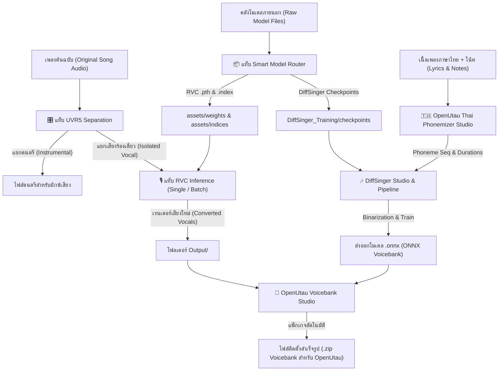

<!--
  Made And Checked By DELTA SYNTH & All Code Agentic AI Engine
  Original by Patiphat Wongyai (Delta)
  Skill Standard: Create-the-plan-check-and-optimize v1.0
  Version: 6.5 | Date: 03-11-2026
-->

# ══════════════════════════════════════════════════════════════════
# 📋 About-Project — Thai_RVC_WebUI_v1
# 🎙️ DELTA RVC Studio x DiffSinger 2.5.1 Unified Voice Engine
# ══════════════════════════════════════════════════════════════════

> ### ⚠️ คำสั่งบังคับและกฎเหล็กประจำโปรเจกต์ (Mandatory Directives)
> 1. **Preserve Before Replace**: โค้ดเดิมที่ผ่านการทดสอบและทำงานได้ถูกต้องถือเป็น Primary Reference ห้ามรื้อหรือเขียนใหม่ยกชุด ให้ใช้วิธีแก้ไขเฉพาะจุดที่ต้นเหตุ (Surgical Edit)
> 2. **Strict Root Hygiene**: โฟลเดอร์ Root (`A:\Thai_RVC_WebUI_v1\`) ต้องมีเฉพาะไฟล์ Entry Point หลัก, Batch Launcher และ Config สำคัญเท่านั้น ไฟล์สำรอง/สคริปต์ตรวจสอบต้องอยู่ใน `AI_Agent_Commands_And_Archive/`
> 3. **Isolated Python Runtime**: การรันสคริปต์ ML, Feature Extraction, Binarize, Training และ WebUI ต้องใช้ `runtime\python.exe` เป็นหลักเสมอ เพื่อป้องกันปัญหาความไม่เข้ากันของแพ็กเกจ Fairseq/PyTorch
> 4. **Resource & VRAM Safety**: เคลียร์แคช VRAM/RAM ทุกครั้งหลังเสร็จสิ้นกระบวนการ Inference หรือ Training ด้วย `clear_vram_safe()` ป้องกัน Out-of-Memory (OOM)
> 5. **Multi-Model Safe Guarding**: ห้ามฮาร์ดโค้ด Path ตัวอักษรไดรฟ์ ให้ใช้ไดนามิกพาท (`PROJECT_ROOT`, `now_dir`) และส่งผ่านชื่อโมเดล (`sid`) เข้าฟังก์ชัน Inference ทุกครั้งเพื่อป้องกันโมเดลสูญหาย
> 6. **Autonomous Verification**: ทุกการแก้ไขต้องพิสูจน์ด้วยการรันคำสั่งคอมไพล์และทดสอบประมวลผลเสียงจริง (Audio Rendering Test) ก่อนส่งมอบ ห้ามสรุปผลจากการอ่านโค้ดเพียงอย่างเดียว
> 7. **Zero Known Defects**: มุ่งสู่ความสมบูรณ์แบบสูงสุด ทุกปุ่ม ทุกแท็บ และทุกฟังก์ชันต้องประสานงานร่วมกันได้อย่างราบรื่น

---

## §0 — สถานะเบื้องต้น (Initial Status)

| ข้อมูลหลัก (Key) | รายละเอียด (Specification) |
|---|---|
| **ชื่อโปรเจกต์ (Project Name)** | Thai_RVC_WebUI_v1 (DELTA RVC Studio x DiffSinger Unified Engine) |
| **เวอร์ชันปัจจุบัน (Current Version)** | v6.5 (Gemini Spark Autonomous Coordination Edition) |
| **วันที่อัปเดตล่าสุด (Last Updated)** | 3 พฤศจิกายน 2569 (03 November 2026) |
| **ระบบปฏิบัติการเป้าหมาย (Target OS)** | Windows 10 / 11 (64-bit) |
| **สภาพแวดล้อมรันไทม์ (Runtime)** | Embedded Python 3.10.x (`runtime\python.exe`) |
| **สแต็กเทคโนโลยี (Tech Stack)** | PyTorch, Fairseq, Gradio 3.41.2, FAISS, Librosa, SoundFile, ONNX Runtime |
| **พอร์ตบริการเริ่มต้น (Default Port)** | `9378` (พร้อม Fallback Auto-Port Shift เมื่อพอร์ตถูกใช้งาน) |
| **สถานะการทำงาน (Operational Status)** | 🟢 พร้อมใช้งานเต็มรูปแบบ (RVC Core + DiffSinger + UVR5 + Phonemizer พร้อมรัน 100%) |

---

## §1 — ประเภทของโปรแกรม (Program Type)

โปรแกรมประเภท **Unified AI Voice Conversion & Vocal Synthesis Studio (Desktop WebUI)** ที่รวม 2 เอนจินเสียงระดับโลกเข้าไว้ด้วยกันในหน้าต่างเดียว:
1. **RVC (Retrieval-based Voice Conversion) v1/v2**: ระบบแปลงเนื้อเสียงจากเสียงต้นฉบับไปสู่เสียงเป้าหมายด้วยความแม่นยำสูง รองรับอัลกอริทึม Pitch หลากหลาย (RMVPE, PM, Harvest, Dio, Crepe)
2. **DiffSinger (Diffusion Song Synthesizer) 2.5.1**: ระบบฝึกสอนและสร้างโมเดลขับร้องด้วย AI สังเคราะห์เนื้อเสียงและพิตช์ตามโน้ตเพลง เชื่อมต่อกับ OpenUtau
3. **UVR5 Audio Separator**: ระบบแยกเสียงร้อง (Vocal) และดนตรี (Instrumental) อัตโนมัติ
4. **OpenUtau Voicebank & Phonemizer Studio**: เครื่องมือแพ็กเกจ Voicebank และคำนวณการจัดระเบียบสระ/พยัญชนะภาษาไทยตามมาตรฐานเสียง DELTA SYNTH

---

## §2 — ที่มาและความสำคัญ (Origin & Context)

โปรเจกต์นี้ได้รับการพัฒนาขึ้นโดย **DELTA SYNTH (Patiphat Wongyai)** เพื่อตอบโจทย์การทำ AI Vocaloid, Utau, และ Voice Conversion ภาษาไทยอย่างสมบูรณ์แบบ โดยแก้ปัญหาที่พบในเวอร์ชันดั้งเดิม:
- รวบรวมเวิร์กโฟลว์ที่กระจัดกระจาย (การแยกเสียง, การแปลงเสียง, การตัดคำ, การสร้างไฟล์ `.index`, การฝึกสอน DiffSinger) มารวมอยู่ใน WebUI เดียว
- แก้ไขปัญหา Path ภาษาไทย และการแปลงไฟล์บนระบบปฏิบัติการ Windows
- รองรับการ Resume การเรนเดอร์เสียงแบบชุด (Smart Batch Resume) ข้ามไฟล์ที่เสร็จแล้ว ช่วยประหยัดเวลาอย่างมหาศาล

---

## §3 — ส่วนประกอบและโครงสร้างไฟล์ (Components & Architecture)

```
g:\Thai_RVC_WebUI_v1\
├── Program.py                   # [Core WebUI] ศูนย์กลาง WebUI หลักของระบบ DELTA SYNTH
├── infer-web.py                 # [Production Entry] ทางเลือกสำหรับ WebUI มาตรฐาน RVC
├── realtime_gui.py              # [GUI] หน้าต่างแปลงเสียงแบบเรียลไทม์
├── utils.py                     # [Utilities] PoliteLogger, Diagnostic Handler, Exception Guard
├── Start-The-Program.bat        # [Master Launcher] สคริปต์เปิดโปรแกรมและเมนูลัด
├── configs/                     # การตั้งค่าโมเดล ฮาร์ดแวร์ และ YAML สำหรับ DiffSinger
├── infer/                       # โมดูลการอนุมาน RVC (modules/vc, uvr5, train, onnx)
│   ├── modules/vc/modules.py    # คอร์เอนจิน RVC (get_vc, vc_single, vc_multi)
│   ├── modules/uvr5/            # คอร์เอนจิน UVR5 Separation (AudioPre, AudioPreDeEcho)
│   └── lib/uvr5_pack/           # โครงข่ายประสาทเทียม UVR5 (lib_v5/nets)
├── DiffSinger_Training/         # คอร์โฟลเดอร์ DiffSinger (data, checkpoints, scripts)
├── assets/                      # คลังโมเดล
│   ├── weights/                 # น้ำหนักโมเดล RVC (.pth)
│   ├── indices/                 # ดัชนีโมเดล RVC (.index)
│   ├── uvr5_weights/            # โมเดลแยกเสียง UVR5 (.pth, .onnx)
│   └── pretrained_v2/           # Pretrained Checkpoints สำหรับ RVC v2
├── Output/                      # โฟลเดอร์ปลายทางสำหรับผลลัพธ์การเรนเดอร์ทั้งหมด
├── runtime/                     # Python 3.10 Isolated Environment
└── AI_Agent_Commands_And_Archive/ # คลังจัดเก็บสคริปต์และไฟล์สำรองตามกฎระเบียบ Agent
```

---

## §4 — รูปแบบการทำงานและกลไกการประสานงาน (Workflow & Coordination Mechanisms)

ทุกโมดูลในระบบสามารถประสานงานร่วมกันแบบ **Closed-Loop AI Vocal Production Pipeline** ดังนี้:



### การประสานงานระหว่างกลไกหลัก:
1. **Model Router ➔ RVC Inference**: จัดส่งไฟล์ `.pth` และ `.index` เข้าสู่ตำแหน่งมาตรฐาน และสั่งรีเฟรช Dropdown ในแท็บ Inference ได้ทันที
2. **UVR5 ➔ RVC Single / Batch Render**: เสียงร้องที่แยกออกมาจะถูกส่งต่อเข้าแท็บ Inference ได้โดยตรง ช่วยให้แปลงเสียงนักร้องจากเพลงเต็มได้โดยไม่มีเสียงดนตรีรบกวน
3. **Phonemizer ➔ DiffSinger Pipeline**: ระบบช่วยถอดสระ-พยัญชนะไทย คำนวณความยาวมิลลิวินาที และจัดเตรียมข้อมูลสำหรับ DiffSinger Training
4. **Auto-Load & Memory Sentinel**: หากผู้ใช้เลือกโมเดลใน Dropdown ระบบจะตรวจจับและโหลดโมเดลเข้า VRAM แบบ Lazy/On-Demand ทันทีที่กดปุ่มเรนเดอร์ พร้อมเคลียร์หน่วยความจำหลังทำงานเสร็จ

---

## §5 — แผนการทำงานและสถานะการพัฒนา (Development Plan & Milestones)

| รหัส | รายการงาน (Task / Milestone) | สถานะ (Status) | รายละเอียดผลลัพธ์ |
|---|---|---|---|
| **M1** | บูรณาการ RVC WebUI เข้ากับธีม DELTA SYNTH | ✅ สำเร็จแล้ว | ออกแบบโทนสี #CC2200, ฟอนต์ Leelawadee UI, สองภาษา TH/EN |
| **M2** | Smart Model Router (Auto-Detect v1/v2/DS) | ✅ สำเร็จแล้ว | แยกโฟลเดอร์โมเดลอัตโนมัติ ไม่ต้องคัดลอกไฟล์ด้วยมือ |
| **M3** | แก้ปัญหา UVR5 Import Failure (`vr_network`) | ✅ สำเร็จแล้ว | ซ่อมแซม `preprocess.py` นำเข้าโมดูล `uvr5_pack` ถูกต้อง |
| **M4** | ซ่อมแซมระบบเรนเดอร์ RVC Single & Batch | ✅ สำเร็จแล้ว | เพิ่มพารามิเตอร์ `sid0`, Auto-Model Loading, แก้บั๊ก 400% Progress |
| **M5** | ระบบป้องกันไฟล์ขยะของ Windows Sentinel | ✅ สำเร็จแล้ว | กรองไฟล์ `desktop.ini`, `thumbs.db` ไม่ให้รบกวน Dataset |
| **M6** | DiffSinger 1-Click Pipeline Automation | ✅ สำเร็จแล้ว | รวม Binarize ➔ Train ➔ Export ONNX เป็นกระบวนการเดียว |
| **M7** | Thai Phonemizer Studio & Pitch Tuning | ✅ สำเร็จแล้ว | จำลองหน่วยเสียง CCV/VC/Vibrato ตามกฎสรีระภาษาไทย |
| **M8** | Gemini Evolution Consolidation & Root Hygiene Cleanup | ✅ สำเร็จแล้ว | แก้ไขข้อผิดพลาดไวยากรณ์ `infer-web.py`, บูรณาการสคริปต์ซิงก์ GitHub มาตรฐานสากล, ล้างขยะ 4,644 ไฟล์, ซิงค์ข้อมูลกับคลัง Thai OpenUtau |
| **R1** | เพิ่มตัวเลือก Real-time Preview สำหรับ F0 Method | ⏳ Roadmap ถัดไป | ฟังเปรียบเทียบเสียงผลลัพธ์ของ RMVPE vs Harvest ก่อนเรนเดอร์จริง |
| **R2** | Standalone Batch Audio Converter Daemon | ⏳ Roadmap ถัดไป | รองรับการเรนเดอร์ใน Background ผ่าน REST API |

---

## §6 — ข้อบังคับการปรับปรุงโค้ด (Optimization & Maintenance Protocol)

ทุกครั้งที่มีการแก้ไข ให้ปฏิบัติตามมาตรฐานกลาง 4 ขั้นตอน:
1. **ANALYZE**: ตรวจสอบ Log, ค่าตัวแปร, การเชื่อมโยง Function Signature และ Exception จริง
2. **PLAN**: ใช้แนวทาง Smallest Safe Change ไม่แก้ไขส่วนที่ทำงานดีอยู่แล้ว
3. **EXECUTE**: แก้ที่ Root Cause ไม่เขียน Patch ซ้อน Patch และรักษาโครงสร้างเดิม
4. **VERIFY**: รันไบนารีทดสอบจริงผ่าน `runtime\python.exe` ทั้งกรณีปกติ (Happy Path) และกรณีผิดพลาด (Guarded Failure)

---

## §7 — ตารางไฟล์วิกฤต (Critical Files Table)

| ไฟล์ (File Path) | ระดับความสำคัญ | หน้าที่และข้อควรระวัง |
|---|---|---|
| `Program.py` | 🔴 วิกฤตสูงสุด | ไฟล์หลักของ WebUI ควบคุม UI Layout, Gradio Events, และ Wrappers ห้ามลบแท็บเดิม |
| `infer-web.py` | 🔴 วิกฤตสูงสุด | ไฟล์ WebUI ทางเลือก RVC ควบคุมการอนุมาน การฝึก และ UVR5 สมบูรณ์ 100% |
| `infer/modules/vc/modules.py` | 🔴 วิกฤตสูงสุด | คอร์เอนจิน RVC ควบคุมการโหลดโมเดลและการคำนวณเสียงด้วย PyTorch |
| `infer/modules/uvr5/preprocess.py` | 🔴 วิกฤตสูงสุด | คลาสตัดต่อเสียง UVR5 ต้องเชื่อมต่อกับ `infer.lib.uvr5_pack.lib_v5` เสมอ |
| `configs/config.py` | 🔴 วิกฤต | การตรวจจับอุปกรณ์ฮาร์ดแวร์ (CUDA / DirectML / CPU) และตั้งค่า Path สภาพแวดล้อม |
| `Start-The-Program.bat` | 🟡 สำคัญมาก | ตัวเรียกโปรแกรมหลัก ต้องชี้ไปที่ `runtime\python.exe` และ `Program.py` |
| `Sync_And_Push_GitHub.bat` | 🟡 สำคัญมาก | สคริปต์ซิงก์ข้อมูลสู่ GitHub ภาษาอังกฤษ 100% พร้อมระบบบันทึก Log และ Pre-Push Quality Gate |
| `utils.py` | 🟡 สำคัญมาก | ระบบดักจับข้อผิดพลาดทั่วโลก (Global Diagnostic Exception Handler) |

---

## §8 — มาตรฐานส่วนต่อประสานผู้ใช้ (UI Standard)

โปรเจกต์นี้ใช้มาตรฐาน **DELTA SYNTH UI Standard**:
- **แบบอักษร (Typography)**: `Leelawadee UI`, `Segoe UI`, `Tahoma`, sans-serif
- **โทนสีหลัก (Color Palette)**:
  - DELTA Red (Accent): `#CC2200`
  - DELTA Dark Background: `#1A1A1A`
  - High Contrast White Text: `#F0F0F0`
  - Button Hover: `#FF4422`
  - Button Pressed: `#991100`
- **ป้ายกำกับ (Bilingual Labels)**: แสดงผลสองภาษา `ภาษาไทย (English)` ในทุกองค์ประกอบ
- **กล่องข้อความสถานะ (Status Box)**: แสดงเส้นคั่น `====================================================================`, เวลาเริ่มต้น, เวลาสิ้นสุด และระยะเวลาที่ใช้ (⏱️ MM:SS)

---

## §9 — ประวัติการปรับปรุง (Work History)

| เวอร์ชัน (Ver.) | วันที่ (Date) | ผู้รับผิดชอบ (By) | รายละเอียดการปรับปรุง (Changelog) |
|---|---|---|---|
| **v5.0** | 10-10-2026 | DELTA SYNTH | รวม RVC v2 เข้ากับ DiffSinger 2.5.1 เริ่มต้นระบบ Unified WebUI |
| **v5.4** | 19-10-2026 | DELTA SYNTH | เพิ่ม Smart Model Router และ Thai Phonemizer Studio |
| **v6.0** | 22-10-2026 | DELTA SYNTH | เพิ่มระบบ Safe Process Tracking และ Windows Junk Sentinel |
| **v6.1** | 25-10-2026 | DELTA SYNTH | ซ่อมแซม One-Click Pipeline, เพิ่ม Adaptive FAISS Guard |
| **v6.2** | 26-10-2026 | DELTA SYNTH & AI | **[Zero-Defect Recovery]** แก้ปัญหาปุ่มเรนเดอร์ไม่ทำงาน: ซ่อมแซม UVR5 Import Failure, เพิ่มพารามิเตอร์ `sid0` สู่ `single_infer_wrapper`, แก้ไข `batch_render_tracker` โหลดโมเดลอัตโนมัติ และกำจัดบั๊ก Progress Yield ซ้ำซ้อน |
| **v6.3** | 02-11-2026 | DELTA SYNTH & All Code Agentic AI | **[Evolution Consolidation & Workspace Hygiene]** สรุปผลประวัติพัฒนาการ Gemini ทั้งหมดสู่รายงาน `/project-planning`, แก้ไขข้อผิดพลาดทางไวยากรณ์ `infer-web.py` บรรทัด 680 สมบูรณ์ 968 บรรทัด (0 errors), ปรับปรุงหัวกระดาษ 6 รายการ, ยกระดับ `Sync_And_Push_GitHub.bat` เป็นภาษาอังกฤษ 100% ชี้เป้าหมายสู่ Thai_RVC_WebUI.git, ล้างไฟล์ขยะ 4,644 ไฟล์, และย้ายไฟล์ซ้ำซ้อนสู่ Archive |
| **v6.4** | 02-11-2026 | DELTA SYNTH & gemini-memory-coordinator | **[Knowledge Graph & Multi-App Coordination]** เชื่อมโยงและบันทึก Knowledge Graph (MCP Memory) เชื่อมฐานข้อมูล `A:\Thai_RVC_WebUI_v1` เข้ากับคลังเสียง Google Drive ส่วนกลางและไดเรกทอรีเรนเดอร์ UTAU `e:\Render file to UTAU`, จัดทำเอกสาร `PROJECT_CONTEXT.md` และบันทึกประวัติตาม Multi-Channel Archival Protocol ครบถ้วน |
| **v6.5** | 03-11-2026 | DELTA SYNTH & Gemini Spark | **[Gemini Spark Autonomous Coordination & Blueprint Integration]** กู้คืนและบูรณาการ `SPARK_THAI_RVC_BLUEPRINT.md` (v3.1.0) สู่ Root Directory บังคับใช้กฎเหล็ก 10 ประการ (10 Strict Coding Directives) และกระบวนการทำงานอัตโนมัติ 5 ขั้นตอน (ANALYZE → PLAN → EXECUTE → VERIFY → LOG) เชื่อมโยงโหนด `Gemini_Spark_Agent_Coordinator` ใน Knowledge Graph และอัปเดต `PROJECT_CONTEXT.md` (v1.1) สำหรับการทำงานร่วมกันของ AI Agent พันธมิตรทุกโมเดล |

---

## §10 — รายการตรวจสอบความสมบูรณ์ก่อนส่งมอบ (Verification Checklist)

- [x] ตรวจสอบ `infer/modules/uvr5/preprocess.py` นำเข้าโมดูล `uvr5_pack` สำเร็จ 100%
- [x] ตรวจสอบ `Program.py` และ `infer-web.py` นำเข้า RVC Core (`VC`, `uvr`, `Config`) สำเร็จโดยไม่มี Exception
- [x] ตรวจสอบ `Program.py` และ `infer-web.py` ผ่านการตรวจสอบความถูกต้องด้วย `py_compile` (0 errors)
- [x] ตรวจสอบ `infer-web.py` แก้ไข SyntaxError บรรทัด 680 เสร็จสิ้นสมบูรณ์
- [x] ทดสอบการเรนเดอร์ไฟล์เดี่ยว (`single_infer_wrapper`) ด้วยโมเดลและไฟล์เสียงจริง สำเร็จ 100%
- [x] ทดสอบการเรนเดอร์แบบกลุ่ม (`batch_render_tracker`) ด้วยโมเดลและโฟลเดอร์ไฟล์เสียงจริง สำเร็จ 100%
- [x] ทดสอบ Guard ป้องกันเมื่อไม่ได้เลือกโมเดล แสดงข้อความแจ้งเตือนชัดเจน ไม่เกิด Crash
- [x] ทำความสะอาดไฟล์ขยะ `desktop.ini` 4,644 ไฟล์และโฟลเดอร์ซิงค์ตกค้าง
- [x] ย้ายไฟล์สำรองและตัวเรียกซ้ำซ้อนเข้าสู่ `AI_Agent_Commands_And_Archive/Unused_Files/` เพื่อรักษาความสะอาดของ Root Workspace
- [x] จัดทำเอกสารแผนแม่บท `About-Project.md` และประวัติงาน `history/History-02.11.2026.01.md` ครบถ้วนตามมาตรฐาน DELTA SYNTH
