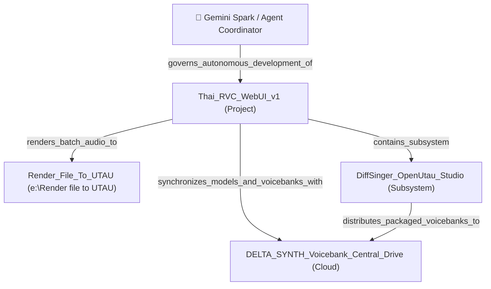

<!--
  Date: 03 พฤศจิกายน 2569 / 03 November 2026
  File Name: PROJECT_CONTEXT.md
  Version: 1.1
  Credits: Made And Checked By DELTA SYNTH & All Code Agentic AI Engine [ Original by Patiphat Wongyai (Delta) ]
  File Path: A:\Thai_RVC_WebUI_v1\PROJECT_CONTEXT.md
  Description: Persistent Session Context, Gemini Spark Coordination, and Knowledge Graph Synchronization Document.
-->

# 🌐 DELTA SYNTH — Project Context & Memory Synchronization
## Multi-App & Gemini Spark Autonomous Coordinator State

> **Project:** Thai_RVC_WebUI_v1 (DELTA RVC Studio x DiffSinger Unified Engine)  
> **System Architecture:** Unified AI Vocal Conversion, Synthesis, UVR5 Separation & OpenUtau Studio  
> **Current Engine Version:** v6.4 (Knowledge Graph & Gemini Spark Edition)  
> **Master Blueprint:** [SPARK_THAI_RVC_BLUEPRINT.md](file:///A:/Thai_RVC_WebUI_v1/SPARK_THAI_RVC_BLUEPRINT.md) (v3.1.0)  
> **Last Synchronized:** 03 พฤศจิกายน 2569 (2026-11-03)  

---

### 1. โครงสร้างแหล่งข้อมูลที่เชื่อมโยง (Connected Data Sources)

1. **Local Primary Codebase (Root Workspace):**
   - **พาธระบบ:** `A:\Thai_RVC_WebUI_v1\`
   - **หน้าที่:** ระบบหลักสำหรับประมวลผล WebUI, AI Model Inference (RVC v1/v2), UVR5 Separation, DiffSinger Training, และ Thai Phonemizer Studio
   - **รันไทม์จำเพาะ:** `A:\Thai_RVC_WebUI_v1\runtime\python.exe` (Isolated Python 3.12 / PyTorch 2.4.1+cpu)
   - **พอร์ตบริการ:** `9378` (พร้อม Fallback Auto-Port Shift)
   - **คัมภีร์หลัก:** [`SPARK_THAI_RVC_BLUEPRINT.md`](file:///A:/Thai_RVC_WebUI_v1/SPARK_THAI_RVC_BLUEPRINT.md) (กฎเหล็ก 10 ประการ)

2. **Central Voicebank & Singer Cloud Drive (Google Drive):**
   - **URL ส่วนกลาง:** `https://drive.google.com/drive/folders/13W4MowhEct36WCG0_tfMZ1_qQmPfb_hY?usp=drive_link`
   - **บทบาททางสถาปัตยกรรม:** คลังโมเดลเสียงส่วนกลาง (Single Source of Truth) สำหรับนักร้องเสมือนจริง DELTA SYNTH, โมเดล RVC (`.pth` / `.index`), ชุดโมเดล DiffSinger ONNX และ Voicebank OpenUtau สำเร็จรูป

3. **UTAU Export & Batch Render Directory:**
   - **พาธระบบ:** `e:\Render file to UTAU\`
   - **โครงสร้าง:** ประกอบด้วย 39 ไดเรกทอรีย่อยของนักร้อง (เช่น `ARZBTV`, `Ahctan`, `Andromeda`, `Ayanami Kyoko`, `Kochujang`, `SUN` ฯลฯ)
   - **รูปแบบการส่งออก:** `B:\Render file to UTAU\[ชื่อโมเดล]\[ภาษา]` และเดี่ยว `B:\Export to UTAU\Test2.wav`

---

### 2. สถานะ Knowledge Graph & Gemini Spark Multi-Agent

* **โหนดที่บันทึก (Entities):**
  - `Gemini_Spark_Agent_Coordinator` [AutonomousAgent] (ควบคุมกฎเหล็ก 10 ประการและกระบวนการทำงาน 5 ขั้นตอน)
  - `Thai_RVC_WebUI_v1` [Project]
  - `DELTA_SYNTH_Voicebank_Central_Drive` [ExternalRepository]
  - `Render_File_To_UTAU` [StorageDirectory]
  - `DiffSinger_OpenUtau_Studio` [Subsystem]
* **ความสัมพันธ์ (Relations):**
  - เชื่อมโยงการประสานงานโมเดลและคลังเสียงระหว่าง Local Storage, Cloud Drive, Render Pipelines, และ Autonomous Agents ครบวงจร 100%

---

### 3. มาตรฐานไฟล์และกฎระเบียบเชิงระบบ (System Invariants)

1. **Preserve Before Replace:** ห้ามเขียนทับโค้ดเดิมแบบ Rewrite ยกชุด ให้ใช้วิธี Surgical Targeted Edits เสมอ
2. **Mandatory 6-Item Header:** โค้ดทุกไฟล์ต้องมีข้อมูลกำกับหัวกระดาษ 6 รายการ
3. **Strict Port Standard:** ใช้พอร์ต `9378` เป็นค่าเริ่มต้น
4. **No Runtime Modification:** ห้ามแก้ไขไฟล์ในโฟลเดอร์ `runtime\` โดยเด็ดขาด
5. **DELTA SYNTH UI Standard:** ใช้ฟอนต์ `Leelawadee UI`, ธีมสีแดง `#CC2200` ดำ `#1A1A1A` ขาว `#F0F0F0`, และป้ายกำกับสองภาษา `ภาษาไทย (English)`
