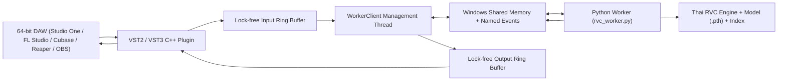

# คู่มือการพัฒนาและการใช้งาน RVC Realtime VST (ภาษาไทย)

[English](./README.en.md) | [简体中文](./README.md) | [ภาษาไทย](./README.th.md)

---

# 1. RVC Realtime VST คืออะไร?

**RVC Realtime VST** คือโครงการพัฒนาปลั๊กอินเสียง (Audio Plugin) สำหรับระบบปฏิบัติการ Windows x64 มาตรฐาน **VST2 และ VST3** จากชุดโค้ดเดียวกัน โดยถูกออกแบบมาเพื่อนำโมเดลเสียง **RVC (Retrieval-based Voice Conversion)** ไปใช้งานแปลงเสียงสดแบบเรียลไทม์ (Real-Time Voice Conversion) โดยตรงภายในโปรแกรมทำเพลง (DAW) เช่น Studio One, FL Studio, Cubase, Reaper, Ableton Live รวมถึงโปรแกรม Live Streaming อย่าง OBS Studio

### จุดเด่นเชิงสถาปัตยกรรม (High-Performance Architecture):
* **ตัวปลั๊กอิน (C++17 + iPlug2):** ตัวปลั๊กอินหลักเขียนด้วยภาษา C++17 ทำงานบนเธรดเสียงของโปรแกรม DAW โดยใช้ระบบ **Lock-Free Ring Buffer** (บัฟเฟอร์วงกลมไร้การล็อก) ในการรับ-ส่งข้อมูลเสียง เพื่อให้การทำงานลื่นไหล ค่าความหน่วง (Latency) ต่ำ และไม่ส่งผลให้โปรแกรม DAW ค้างหรือเสียงแตกกระตุก
* **การแยกโปรเซส (Process Isolation):** การโหลดโมเดล AI และการประมวลผลเสียง RVC จะถูกแยกออกไปรันบนโปรเซสภายนอก ผ่านตัวขับเคลื่อน Python Worker (`worker/rvc_worker.py`)
* **การสื่อสารความเร็วสูง (Inter-Process Communication - IPC):** ส่งผ่านข้อมูลคลื่นเสียงดิบระหว่าง C++ กับ Python ผ่าน **Windows Shared Memory (หน่วยความจำร่วม)** และซิงโครไนซ์สถานะด้วย **Windows Named Events** โดยไม่ผ่านเครือข่าย ไม่ผ่าน HTTP และไม่ผ่าน Stdin/Stdout ทำให้มีความเร็วสูงสุดและปลอดภัยต่อเธรดประมวลผลเสียง



---

# 2. ปัจจุบันสามารถใช้ประโยชน์จากมันได้อย่างไร?

### 2.1 สถานะปัจจุบันในโฟลเดอร์นี้
* โฟลเดอร์ `RVCRealtimeVST` ประกอบด้วย **ซอร์สโค้ดภาษา C++, โมดูล iPlug2, VST3 SDK, และสคริปต์สำหรับคอมไพล์** ครบถ้วน 100%
* ปัจจุบันยัง **ไม่ได้ถูกคอมไพล์ (Build)** เป็นไฟล์ `.vst3` หรือ `.dll` สำเร็จรูป เนื่องจากต้องการเครื่องมือคอมไพเลอร์ C++ (Visual Studio 2022) ประจำเครื่อง

### 2.2 ประโยชน์หลักเมื่อบิลด์เป็นปลั๊กอินแล้ว
1. **การบันทึกเสียงร้องสดในสตูดิโอ (Real-time Studio Vocal Production):**
   * ปลั๊กอินสามารถนำไปเสียบในช่อง Effects / Inserts ของ Track เสียงร้องในโปรแกรม DAW
   * นักร้องสามารถสวมหูฟังและได้ยินเสียงตนเองที่ถูกแปลงเป็นเสียงโมเดล AI ในทันทีขณะร้องเพลงสด
   * ไม่ต้องเสียเวลาบันทึกเสียงเป็นไฟล์ WAV แล้วเปิดเว็บเบราว์เซอร์เพื่อแปลงเสียงทีละไฟล์อีกต่อไป
2. **การไลฟ์สตรีม / สวมบทบาทตัวละคร (Live Streaming / VTuber / Discord):**
   * รองรับการใส่เป็น **Audio Filter (VST 2.x Plug-in)** ใน **OBS Studio**
   * แปลงเสียงพูดสดผ่านไมโครโฟนระหว่างการสตรีมเกม, บรรยายสด, หรือส่งสัญญาณผ่านสายสัญญาณเสียงเสมือน (Virtual Audio Cable / VoiceMeeter) ไปยัง Discord
3. **การควบคุมแบบอินเทอร์แอคทีฟ (Interactive GUI):**
   * มีหน้าต่าง GUI ของปลั๊กอินใน DAW สำหรับเลือกโมเดลเสียง (`.pth`), ไฟล์ดัชนี (`.index`), ปรับระดับคีย์เสียง (+/- Pitch Semitones) และเลือกอัลกอริทึม Pitch Extraction (RMVPE, FCPE, PM) ได้แบบสดๆ

---

# 3. ข้อกำหนดและสิ่งที่ต้องเตรียมสำหรับการ Build

หากต้องการคอมไพล์ซอร์สโค้ดนี้ออกมาเป็นปลั๊กอิน `.vst3` และ `.dll`:

* **ระบบปฏิบัติการ:** Windows 10 หรือ Windows 11 (64-bit)
* **เครื่องมือคอมไพเลอร์ (Compiler):**
  * Visual Studio 2022 หรือ Visual Studio Build Tools 2022
  * ติดตั้ง Workload: **Desktop development with C++** (MSVC v143 และ Windows 10/11 SDK)
* **CMake:** เวอร์ชัน 3.14 ขึ้นไป (แนะนำ 3.26+)
* **Git:** สำหรับตรวจสอบและดึง submodule ของ iPlug2 และ VST3 SDK
* **Windows PowerShell:** เวอร์ชัน 5.1 หรือ PowerShell 7

---

# 4. ขั้นตอนการ Build VST2 และ VST3

เปิด PowerShell ในฐานะ Administrator แล้วเข้าไปที่โฟลเดอร์ `RVCRealtimeVST`:

```powershell
cd A:\Thai_RVC_WebUI_v1\RVCRealtimeVST
powershell -ExecutionPolicy Bypass -File .\scripts\build.ps1
```

สคริปต์จะดำเนินการอัตโนมัติ:
1. ตรวจสอบ submodule (`iPlug2`, `vst3sdk`)
2. จัดเตรียมโครงสร้าง SDK
3. สร้างโปรเจกต์ CMake ด้วย Visual Studio 2022 x64
4. คอมไพล์ในโหมด Release ทั้ง VST2 และ VST3
5. สร้างโฟลเดอร์ปลายทาง `dist/` พร้อมแพ็กเกจ `RVCRealtime-Win64.zip`

### ผลลัพธ์ไฟล์ไบนารีหลังการ Build สำเร็จ:
```text
dist/
|-- RVC Realtime.dll                              # ปลั๊กอินรูปแบบ VST2 (64-bit)
|-- RVCRealtime.vst3/                             # ปลั๊กอินรูปแบบ VST3 Bundle (64-bit)
|-- RVCRealtime.resources/worker/rvc_worker.py    # สคริปต์บริดจ์ Python สำหรับสื่อสารกับโมเดล
`-- RVCRealtime-Win64.zip                         # ไฟล์แพ็กเกจพร้อมติดตั้ง
```

---

# 5. วิธีการติดตั้งและเริ่มใช้งาน

1. นำโฟลเดอร์ `RVCRealtime.vst3` ไปวางที่:
   ```text
   C:\Program Files\Common Files\VST3\
   ```
2. (ทางเลือกสำหรับ VST2) นำไฟล์ `RVC Realtime.dll` ไปวางที่โฟลเดอร์ VST2 ของโปรแกรมทำเพลง เช่น:
   ```text
   C:\Program Files\VstPlugins\
   ```
3. เปิดโปรแกรม DAW (เช่น FL Studio, Studio One, Reaper) หรือ OBS Studio แล้วสั่งสแกนปลั๊กอินใหม่
4. เมื่อเปิดปลั๊กอินขึ้นมา ให้ระบุตำแหน่งของ:
   * **RVC Package Root:** `A:\Thai_RVC_WebUI_v1`
   * **Python Executable:** `A:\Thai_RVC_WebUI_v1\runtime\python.exe`
   * **Model Path:** โฟลเดอร์หรือไฟล์ `.pth` ใน `assets/weights/`
5. เริ่มพูดหรือร้องเพลงผ่านไมโครโฟนเพื่อสัมผัสการแปลงเสียงสดได้ทันที

---

*เอกสารจัดทำขึ้นโดย DELTA SYNTH & All Code Agentic AI Engine เพื่อเป็นคู่มืออ้างอิงของโครงการ Thai RVC WebUI*
